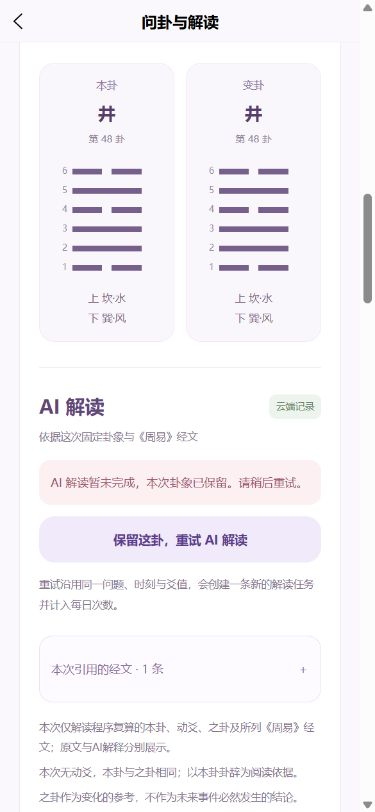
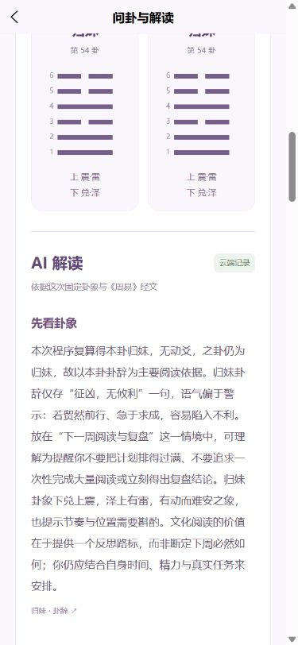

# 前台直达入口、自动问卦与 AI 解读验收

验收日期：2026-10-03（Asia/Shanghai）。本记录区分自动化检查、本地浏览器操作、真实模型调用与生产发布，未完成的项目不计为通过。

当前结论：代码检查、本地交互、一次独立真实模型调用及生产发布验收通过。正式站已完成自动起卦、真实 AI 解读、刷新回看、复制 JSON 导出与离线复算；135 个公网资源通过校验。手机尺寸使用浏览器模拟，实体手机与浏览器原生下载落盘仍未验证。

## 本轮交付范围

- 首页直接按山、医、命、相、卜展示十八个工具入口，突出自动问卦和主题同读，并保留原八字入口。
- 问卦页默认填写问题后模拟三枚钱、连续六次起卦，可选择仅在本机起卦，或将本次问题和起卦资料提交 AI 解读。原六爻手录、六爻纳甲、梅花两数与梅花时间法继续可用。
- 卦象先由程序确定；AI 重试沿用原问题、币值、爻值和时刻。程序事实、固定版本经文及 AI 解释分别展示，引用指向本次证据包。
- AI 任务使用独立的云端记录与额度；支持读取进度、失败重试、回看、终态删除和 JSON 导出。原本机问事记录仍可保存、刷新回看和导出。
- 经文来源保留固定修订链接、资料版本、署名和 CC BY-SA 4.0 许可。新增 `sourceLicense` 随事实包和 AI 导出携带，许可链接可供核对。

设计、计算口径与接口约定见[先行调研与实施契约](divination-ai-research-2026-10-03.md)；经文选择与资料处理见[经文来源调研](research/divination-ai-sources.md)。原有方法的范围见[基础易卦记录](divination-phase2.md)、[梅花时间起卦](divination-phase3.md)与[六爻纳甲](divination-phase4.md)。

## 自动化检查

| 检查 | 结果 | 说明 |
| --- | --- | --- |
| 前端 `npm test` | 535 项通过 | 包含起卦、旧记录兼容及 AI 会话控制器行为测试 |
| 前端 `typecheck` | 通过 | TypeScript 与 Vue 类型检查 |
| H5 构建 | 通过 | 构建产物通过生成检查 |
| 微信小程序构建 | 通过 | 仅构建验证，不等同于小程序运行验收 |
| 后端测试 | 320 项通过 | 包含独立任务、接口与已有功能回归 |
| 增加 `sourceLicense` 后的核心复跑 | 32 项通过 | 单列复跑结果，不与 320 项相加作为不同测试数量 |

AI 会话控制器另有 9 项针对性测试，覆盖：连续点击只创建一次任务、网络结果不明时复用请求标识、明确失败重试创建新标识但保留同卦、输入变化隔离迟到响应、页面隐藏停止轮询、读取失败只重试 GET、历史记录切换隔离旧响应、自动轮询次数上限，以及缺少分析内容时不显示成功。这些测试已包含在前端检查中。

## 独立真实模型调用

部署前的独立验收调用了一次真实 DeepSeek，使用明确标注为公开验收用途的虚构问题：

> 这是公开验收用的虚构问题：我怎样安排下一周的阅读和复盘？

- 独立调用证据记录的模型：`deepseek-flash`；正式网页及生产导出的模型标签为「猫来运转 AI」。
- 耗时：11.756 秒。
- 输入 1617 tokens，输出 1048 tokens。
- 固定输入自下而上为 `[9, 7, 9, 6, 7, 6]`，本卦需、变卦讼，动爻为 1、3、4、6。
- 返回结构化分析，并通过本次事实回显与合法证据引用校验。
- 此次调用不写数据库，验证的是实际模型调用与结构化响应；生产网页端到端验收另有下方证据。

完整公开输入、确定性事实、经文证据及模型响应保存在[真实调用验收 JSON](verification/divination-ai-live-20261003.json)。本地浏览器验收采用无 AI 密钥环境，两项证据相互独立。

## 本地浏览器交互

环境为独立的本地 API 与 SQLite，未配置 AI 密钥。使用浏览器模拟 320px 和 390px 视口；由于系统滚动条，可用页面宽度分别为 305px 和 375px。两个尺寸均未发现水平溢出。

| 用户路径 | 已观察结果 |
| --- | --- |
| 打开首页 | 十八个工具入口直接可见，按五术分组，可进入对应页面 |
| 默认自动三钱起卦 | 实际生成井卦；爻值 `[8, 7, 7, 8, 7, 8]`，无动爻，本卦与变卦均为井 |
| 选择仅起卦 | 生成本机结果，没有创建 AI 任务 |
| 请求 AI 解读 | 无密钥时明确显示失败，保留已生成的币值、卦象和问事时刻 |
| 对失败解读重试 | 创建任务 #2，原任务为 #1；两次使用相同币值、爻值和时间，没有重新随机起卦 |
| 核对独立额度 | 剩余次数由 5 变为 4，再变为 3；失败任务仍计入接受次数 |
| 刷新页面及回看 | 两条云端记录与一条本机记录仍存在；回看恢复原卦 |
| 核对控制台 | `error: []` |

390px 失败保卦界面证据：

## 本地导出与重放

本次从实际导出面板取得的本机记录 JSON 已保存为[本地界面导出证据](verification/divination-local-ui-export-20261003.json)。使用 esbuild 加载起卦域模块，按导出中的原始输入和规则版本重放，重放结果与导出 `result` 逐字段完全相等。

本地验收时，浏览器工具未成功取得下载事件或剪贴板内容。界面如实提示下载/复制状态，并提供完整 JSON 供手动复制。因此这项本地证据验证的是导出内容可取得、内容完整且可复算；当时未验证浏览器实际下载文件已落盘或剪贴板复制成功。之后的生产验收已验证复制 JSON 成功，见下方独立记录；原生下载落盘仍未验证。

## 生产发布与公网核验：通过

本轮已完成完整备份、后端镜像构建、数据库迁移、服务切换与公网核验。发布和回退记录见[本轮服务器验收](mobile-server-divination-acceptance-2026-10-03.md)；服务器回执见[发布证据](verification/divination-20261003-115936-server.json)，逐资源核验见[公网证据](verification/divination-20261003-115936-public.json)。

| 项目 | 已知状态 |
| --- | --- |
| 发布标识 | `divination-20261003-115936` |
| 发布包 SHA-256 | `c55c651dad9e71d8c4434c023da38edea163927db97e0c3a4cec2fc2784ebe06` |
| 服务器完整备份 | `/root/oasis-backups/divination-20261003-115936`，已完成 |
| 新后端镜像 | `oasis-backend:divination-20261003-115936`，镜像 ID `sha256:b594214d581f5b60eec1536ffc2440b399a26906b26fbc7fecb2423b1a4893bc` |
| 旧镜像保留 | `oasis-backend:before-divination-20261003-115936` |
| 数据库迁移 | 已执行至 `d9f2a67b103c` |
| 服务切换 | 新后端于 `2026-10-03T12:20:17Z` 启动，容器为 `healthy`，健康接口为 `ok` |
| Caddy 与数据库容器 | 容器 ID、镜像及启动时间与发布前一致 |
| 公网核验时刻 | `2026-10-03T12:24:40Z`（北京时间 20:24:40） |
| 公网资源 | 135 个文件，TLS 验证开启；HTTP 状态、MIME、SHA-256 与缓存头通过核验 |
| 未登录接口 | 问卦记录与原报告接口均返回 401 |

迁移脚本见[数据库迁移 SQL](verification/divination-migration-20261003.sql)，实际迁移版本及容器切换状态以发布回执为准。完整备份与旧镜像均保留，作为回退依据。

## 正式网页端到端验收：通过

在正式站使用 390px 模拟手机视口，公开验收问题为「公开上线验收用的虚构问题：我怎样安排下一周的阅读和复盘？」。页面对外模型标签为「猫来运转 AI」，生产导出的 `model` 字段也是该标签，不包含内部模型名称。

| 用户路径 | 已观察结果 |
| --- | --- |
| 首页直达 | 十八个工具入口可见，可从首页进入自动问卦 |
| 点击一键生成 | 起卦时刻为 `2026-10-03 20:22`（UTC+8），六爻自下而上为 `[7, 7, 8, 7, 8, 8]`；本卦与变卦均为归妹第 54 卦，无动爻 |
| 请求真实 AI 解读 | 云端任务 #1 完成，返回完整解读；独立额度由 5 变为 4 |
| 展开经文 | 归妹卦辞、固定修订来源和 CC BY-SA 4.0 许可可见 |
| 点击复制 JSON | 复制成功，取得剪贴板中的真实完整导出内容 |
| 刷新与回看 | 云端列表仍只有已完成的 #1；恢复相同问题、时刻、全部 18 个币值、六爻、归妹卦及原完整解读；额度仍为 4，没有再次提交 |
| 布局与控制台 | `clientWidth = scrollWidth = 375`，无横向溢出；控制台 `error: []` |

实际页面复制所得内容保存在[生产界面导出 JSON](verification/divination-production-ui-export-20261003.json)，离线复算回执见[生产导出复算](verification/divination-production-ui-replay-20261003.json)。回执为 `ok: true`：完整 `facts` 逐字段一致、18 个币值及六次和数一致、实际 `analysis` 结构校验通过、引用 `zhouyi.54.judgment` 合法，CC BY-SA 4.0 许可、署名与修改说明完整。

生产已验证的是页面复制、剪贴板内容取得及导出离线复算。证据 JSON 的保存不等同于浏览器原生下载文件落盘；后者仍未验证。

## 本次尚未覆盖

- 没有实体手机浏览器验收；320px/390px 是模拟视口。
- 没有微信开发者工具或真机小程序运行验收；小程序仅完成构建。
- 无密钥环境用于验证失败路径；真实 AI 成功分别有独立调用与正式网页端到端证据。
- 未验证浏览器原生下载文件落盘；生产页面复制 JSON 与剪贴板内容取得已通过。
- 传统卦象和经文解释的计算一致性、结构化引用校验，不代表现实预测效力得到验证。
