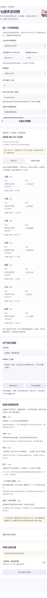
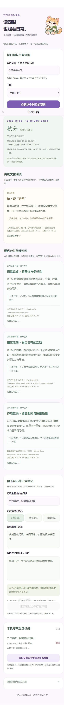
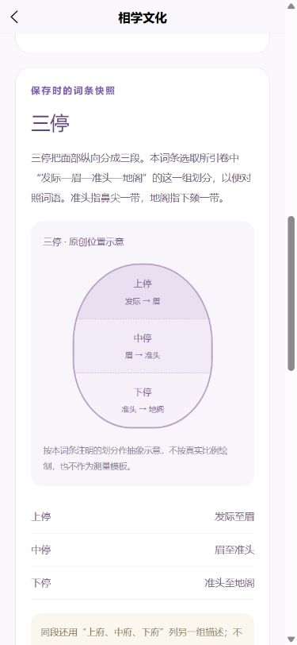

# 第七批：七政天文、节气生活与相学文化

2026-10-03。各项均是范围明确的本机工具，不代表十八板块全部完成。

## 本次交付

- 七政天文对照：七曜日期真黄道与赤道坐标、现代去极度、时区解析和本机20份完整快照。独立Swiss星历168个坐标核对，最大差19.932角秒。四余、二十八宿、立命和古历度制缺少统一参考盘，不输出这些数值。详细见[qizheng-phase6.md](../oasis-uniapp/docs/qizheng-phase6.md)及[验证规格](../oasis-uniapp/docs/research/qizheng-validation.md)。
- 节气生活：按日期中午UTC+8归入四时目录，传统文化卡和WHO/CDC现代公共健康资料分开；主题筛选、自选习惯状态和笔记保存50份完整快照。七张卡均注明来源、版本或发布日期及复核日期。详细见[seasonal-care-phase6.md](seasonal-care-phase6.md)。
- 相学文化：八个有版本出处的术语、文献及批评视角词条，简繁关键词检索、原创三停示意、50份独立文化笔记。固定《古今图书集成》《荀子·非相》《太清神鉴》提要的文库修订号，说明署名争议；不采集人物照片或作个体推断。详细来源和边界见[验证规格](research/physiognomy-validation.md)。

## 实际验收

- 最新前端全量测试379项通过，包含七政14项、节气生活16项、相学文化9项及大六壬领域测试。大六壬页面验收单独继续，不以测试数字冒充UI验收。
- 含七政、节气生活、相学文化、奇门入口的H5及微信编译通过，类型检查通过；之后并行新增页面另做全量检查。后端本批未改，上一轮隔离回归214项通过。
- 内置浏览器 `127.0.0.1:5187` 已分别保存合成验收记录，刷新页面后打开原快照：七政“七政验收：黄赤道对照”；节气“节气验收：观察晚间作息”；相学“文化验收：核对三停的原文定位”。数值、卡片/词条、笔记及来源保留。
- 七政从既有出生档案只读填入2000-08-16 12:00、Asia/Shanghai，确认UTC04:00，黄赤道切换可用。太阳黄经143.5928°、赤经145.9174°、现代去极度76.3448°。相学“三停”检索仅一条，无匹配词展示空状态。
- 三页均检查320像素视口，根元素可用宽度305、滚动宽度305，无横向溢出；390像素视口保存完整截图。控制台未出现错误。这是桌面浏览器视口模拟，不是真机结果。
- `scripts/verify-metaphysics-exports.mjs` 从生产序列化接口产生14份UTF-8合成JSON，写入磁盘后逐字节读回、解析并比较，包含本批三类。记录见[manifest](verification/exports/manifest.json)。浏览器下载事件此前未被内置浏览器返回，实际下载完成仍单列未确认。
- Android、iPhone Safari和微信真机未连接；生产发布未执行。

## 图像证据

继续：八字／紫微细分运限、西方宫制／双人相位、大六壬、太乙、空间八宅及跨体系主题阅读。
