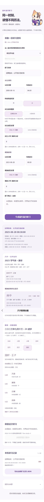
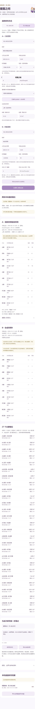
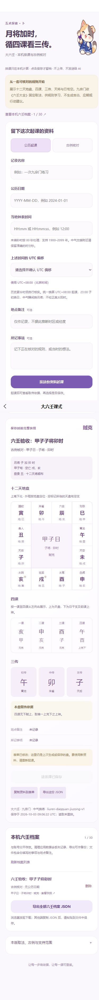
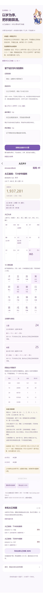
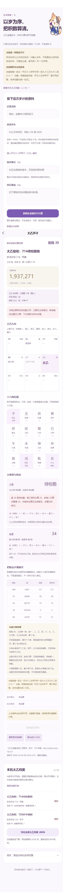
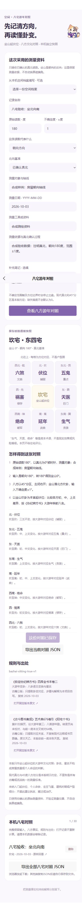

# 细分运限、星盘比较、六壬、太乙与八宅的集成验收

2026-10-03。沿用既有三盘和独立档案，不改服务端账号报告。各算法的来源、规则版本、独立样例和局限分别在模块说明中登记。

| 模块 | 本期范围 | 实际页面验证 |
| --- | --- | --- |
| 八字／紫微细分运限 | 八字流年和十二节月十神；紫微本命、大限、小限、流年、流月、流日、流时各层四化 | 公开例2000-08-16 04:30女，观测2023-08-28 00:30 UTC+8：流日戊午、流时壬子、小限丁亥；展开12个月，保存刷新回看通过 |
| 西方星盘研究 | 整宫／ASC等宫，双人十天体100组合的五种主要相位，统一6°容许度 | A只读填旧出生档案，B另填UTC0和大约时间；A有两套宫位、B无宫位，27个主要相位，保存刷新回看通过 |
| 大六壬 | 固定中气换将、日界与贵人，九宗门天地盘四课三传，古例/公历两种输入 | 甲子日子将卯时例：三传午卯子、青龙朱雀天后，贼克；保存刷新原盘通过 |
| 太乙 | 《金镜式经》四库本岁计、724锚、阳局与主客行算 | 724积1937281、阳49、主24客25；714阳39主算/主将待校勘、客34。两种均保存刷新原样回看 |
| 八宅 | 真北坐山起伏位，大游年八方与逐爻变化 | 磁北拒绝自动换算；朝向180±1°得到坐山0°坎宅，保存刷新；202±1°触边界拒绝新盘，原记录仍可恢复 |

专题：[细分运限](flow-study-phase7.md)、[西方比较](../oasis-uniapp/docs/western-study-phase7.md)、[六壬](liuren-phase7.md)、[太乙](taiyi-phase8.md)、[八宅](bazhai-phase8.md)。

本轮全量前端469项通过；类型、H5、微信编译通过至六壬/细分运限/西方比较/八宅入口。太乙入口后来注册，最终全量编译仍需再次执行。新的主题同读和清历宿度仍开发中，不将这轮通过沿用为它们的验收。

五页在桌面内置浏览器的320像素视口检查，根宽305、滚动宽305，未发现横向溢出；390像素视口留存截图，控制台无错误。截图为视口模拟，Android、iPhone Safari、微信真机未提供连接，生产部署未执行。

生产JSON序列化与真实磁盘写入、读回核对记录统一见[导出manifest](verification/exports/manifest.json)。此证据不冒充内置浏览器下载事件已完成。

