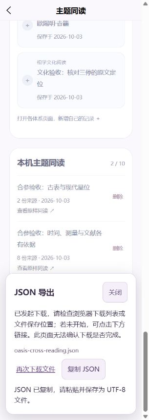

# 命卜前台范围与十八板块历史验收

2026-10-03。当前生产前台已收敛为命 8 项、卜 6 项，共 14 个工具入口；山、医、相相关四板块的五个页面取消注册，代码与历史数据保留。新建主题同读开放当前 14 类来源，旧 19 类来源快照继续兼容。本批 `h5-ming-bu-20261003-124937` 已正式上线，详见[本批范围与完整验收](ming-bu-front-page-2026-10-03.md)。

本批同读新旧兼容专项 23 项、`vue-tsc`、H5 与 `mp-weixin` 正式构建通过；320／390 CSS 像素视口两张首页主卡同尺寸且无横向溢出。正式站 390 视口的命、卜主入口已真实点击通过；本地正式包中旧修习书签在首次加载或刷新时回首页并提示关闭，未把页面内 hash 变化算作已验证。119 个公网资源的逐字节 SHA-256、MIME、`no-cache`、状态与正常 TLS 验证通过，健康检查 `ok`、匿名报告接口 401，三个服务容器发布前后状态完全相同。见[服务器回执](verification/h5-ming-bu-20261003-124937-server.json)、[公网回执](verification/h5-ming-bu-20261003-124937-public.json)与[生产截图](verification/ming-bu-production-390-20261003.png)。

下文保留此前十八板块、主题同读以及自动起卦与 AI 的实际交付和生产证据。历史能力台账不代表当前前台仍开放十八项；各批构建、浏览器测试、设备实测与生产状态分别记录。

## 历史交付：十八板块与主题同读

- **主题同读**：19类已保存来源，自选2–8份，保留完整副本、原时间、规则、出处、个人笔记及差异；10份独立同读档案。无总评分、无模拟AI解读、不自动认定人物与事件关系。旧易卦只含输入，创建时明确按原规则重建一次，再保存整份结果；回看不重新起卦。[实现与H5证据](cross-reading-phase8.md)。
- **清历宿度查算**：独立于现代七政，固定《历象考成》1684基准表的28宿及每年51角秒整年推移，接受明确年标号与宫度。原书太阳例与10项独立古例核对；室/房异文和非基准年位置局限明示。[底本与验证](../oasis-uniapp/docs/research/qizheng-lodges-validation.md)、[页面验收](../oasis-uniapp/docs/qizheng-lodges-phase8.md)。
- **跨页面资料兼容**：修复细分运限隐藏偏移为空时的IANA存档问题，以及印度占星/七政复制长档案名后超出40长度导致保存失败的问题。回归覆盖中文、补充字符与混合边界；来源资料、时区重复时刻选择和原快照保留。
- **导航与文档**：探索页增加主题同读入口，七政页增加清历宿度入口；各板块范围与实际实现同步。修正7处跨目录文档链接。

## 验证边界

收尾导出面板之前：前端全量513项通过，类型检查、H5与微信编译通过。19类同读专项20项、清历宿度专项20项；共享资料导入、Jyotish与七政联合37项通过。后端之前隔离回归214项通过，本批没有后端代码变更。

H5实测完成八来源11卡同读和古今坐标两来源同读的保存、刷新、回看；第9份选择被明确拒绝且已有选择保留。清历宿度完成空表单、1684古例、1685年移、精确宿界及保存刷新。320/390像素布局未发现横向溢出；控制台错误为空。

21份生产序列化合成JSON已实际写入文件、读回逐字节与逐字段核对；同读文件包含八来源组合及古今两来源组合。见[文件清单与哈希](verification/exports/manifest.json)。这些是生产序列化接口输出，不冒充浏览器下载完成。

Android、iPhone Safari、微信真机未连接。此前十八板块与主题同读批次在本地收尾后，按用户指令于同日完成[服务器发布与公网验收](mobile-server-acceptance-2026-10-03.md)。该次静态发布不包含本文末尾新增的自动起卦与 AI 后端；后者已完成独立生产发布与验收。构建、桌面浏览器、设备实测与生产状态分别记录。

## 共用导出与最终验证

H5各页继续发起下载，并显示共用导出面板，保留可再次点击的下载链接、手动复制JSON按钮与关闭操作。仅用户点击复制才写剪贴板；失败可重试或从只读文本手工复制；新导出替换旧面板，关闭/替换撤销Blob URL。Escape可关闭并恢复原导出按钮焦点。没有读取额外存储或上传数据，不把“已发起”显示成“已下载完成”。

桌面内置浏览器仍未给出原生下载完成事件，单次可见链接保存等待15秒超时后即改用已实现的备用路径，没有把超时算成成功。随后逐页点击导出及“复制JSON”，生成20份实际页面文件，覆盖19类来源和26条合成记录；每份在UTF-8写入后逐字读回一致，再通过对应生产仓库/快照校验。三盘保留八字、紫微与西方三份结果；易卦的导出结果逐份依原规则核对；同读中的太乙空值、未知方向、重建来源说明与古今坐标区别均保留。没有直接读取浏览器存储来代替页面操作。

证据：[逐页操作记录](verification/browser-exports/ui-actions.json)、[文件大小与SHA-256](verification/browser-exports/manifest.json)。复核命令：在`oasis-uniapp`运行`node scripts/verify-ui-metaphysics-exports.mjs`。这些文件与此前21份合成序列化文件是两套不同证据。

导出面板320px视口内宽280.67px，根宽/滚动宽均305px，无水平溢出；键盘关闭后焦点回到原“导出全部同读JSON”按钮。最终全量前端 **520/520通过**，`npm run typecheck`、`npm run build:h5`、`npm run build:mp-weixin`均成功。编译仅有已有Sass旧API提示。新共用导出行为回归7项，不伪造下载完成事件。

此前十八板块的注明范围与主题同读已[部署至正式服务器](mobile-server-acceptance-2026-10-03.md)；设备与原生下载仍按上述条件保留为未实测。没有自动补造范围外的四余、未核盘法、身份关系或综合命运评分。

## 已完成的历史批次：前台直达、自动起卦与 AI 解读

本轮本地开发和验证已完成。首页按五术直接展示十八个工具入口，突出自动问卦和主题同读；问卦默认模拟三枚钱、连续六次生成卦象，也可仅在本机起卦。原六爻手录、六爻纳甲、梅花两数与梅花时间法继续可用。

卦象由程序先行确定，AI 根据本次事实和固定版本经文生成解读。失败保留原卦，重试沿用原问题、币值、爻值和时刻；云端任务、进度、独立额度、历史回看、终态删除与 JSON 导出已接入。经文保留来源、版本、署名与 CC BY-SA 4.0 许可，程序事实、原文证据与 AI 解释分区展示。自动起卦与卦象 AI 已不属于未实现功能，其他流派或自动用神旺衰应期等范围仍按各自规格处理。

本轮前端全量 **535 项通过**，后端 **320 项通过**；前端类型检查、H5 与微信小程序构建通过。补充 `sourceLicense` 后的核心复跑 32 项单列记录，不叠加到后端全量数量。一次真实 DeepSeek 调用通过事实回显与证据引用校验；本地浏览器使用无 AI 密钥环境，验证仅起卦、失败保卦、同卦重试及刷新回看，两项验收证据分别保存。

320px／390px 手机尺寸为浏览器模拟视口，未连接实际手机设备或运行真机小程序。本地备用 JSON 导出已取得并复算；生产页面「复制 JSON」已成功取得完整剪贴板内容，离线复算事实逐字段一致，解读结构、引用和许可署名校验通过。浏览器原生下载到磁盘仍未验证。

本轮生产发布 `divination-20261003-115936` 已完成备份、迁移至 `d9f2a67b103c` 和后端切换，新后端健康正常；Caddy 与数据库容器 ID、镜像及启动时间未变。135 个公网资源的 TLS、状态、MIME、哈希与缓存核验通过，见[本轮服务器验收](mobile-server-divination-acceptance-2026-10-03.md)、[服务器回执](verification/divination-20261003-115936-server.json)和[公网回执](verification/divination-20261003-115936-public.json)。

正式站 390px 浏览器验收完成：首页十八入口可见，一键起卦生成归妹第54卦、无动爻，六爻 `[7, 7, 8, 7, 8, 8]`；云端 #1 的真实 AI 解读完成，额度5→4。刷新回看恢复原问题、时刻、18个币值、卦象与完整解读，额度保持4；经文与 CC BY-SA 来源可展开。生产导出的模型标签为「猫来运转 AI」。页面无横向溢出，控制台错误为空。

设计与计算口径见[自动起卦与 AI 调研](divination-ai-research-2026-10-03.md)，完整检查、生产截图与交互记录见[本轮验收](divination-ai-acceptance-2026-10-03.md)；实际[生产页面复制导出](verification/divination-production-ui-export-20261003.json)与[离线复算回执](verification/divination-production-ui-replay-20261003.json)分别保存。
